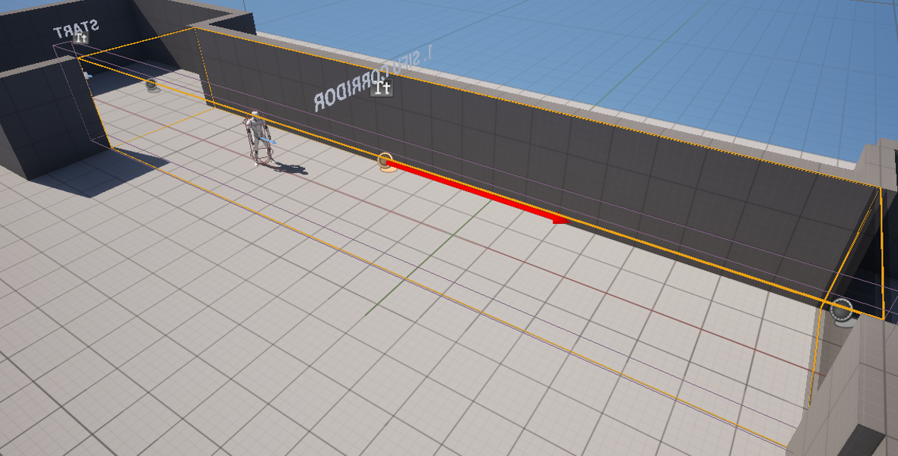
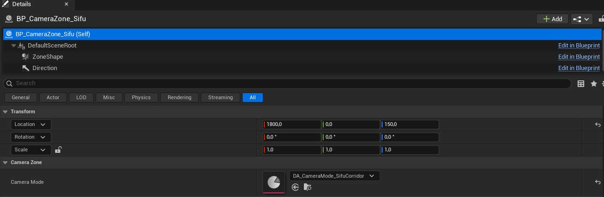
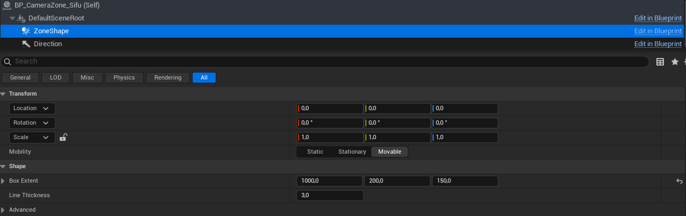
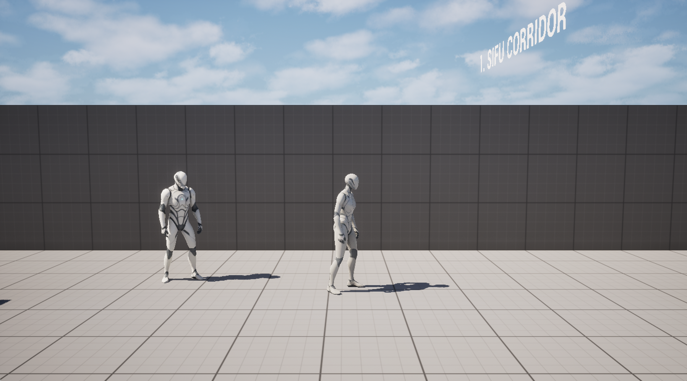
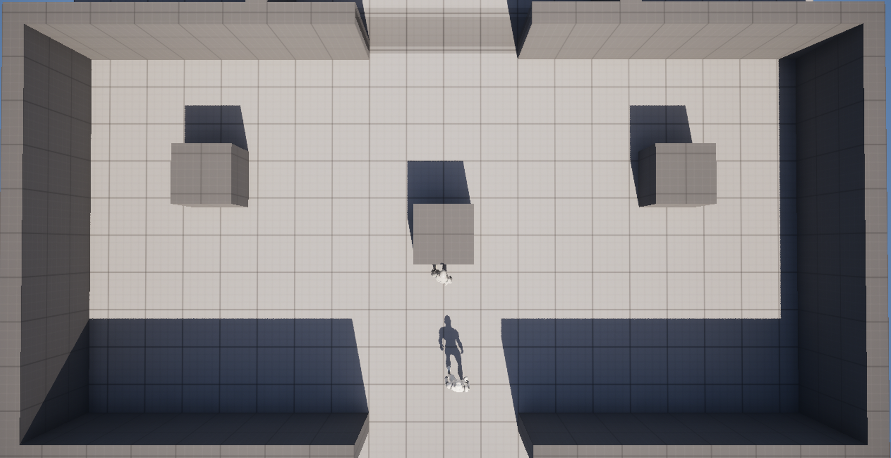
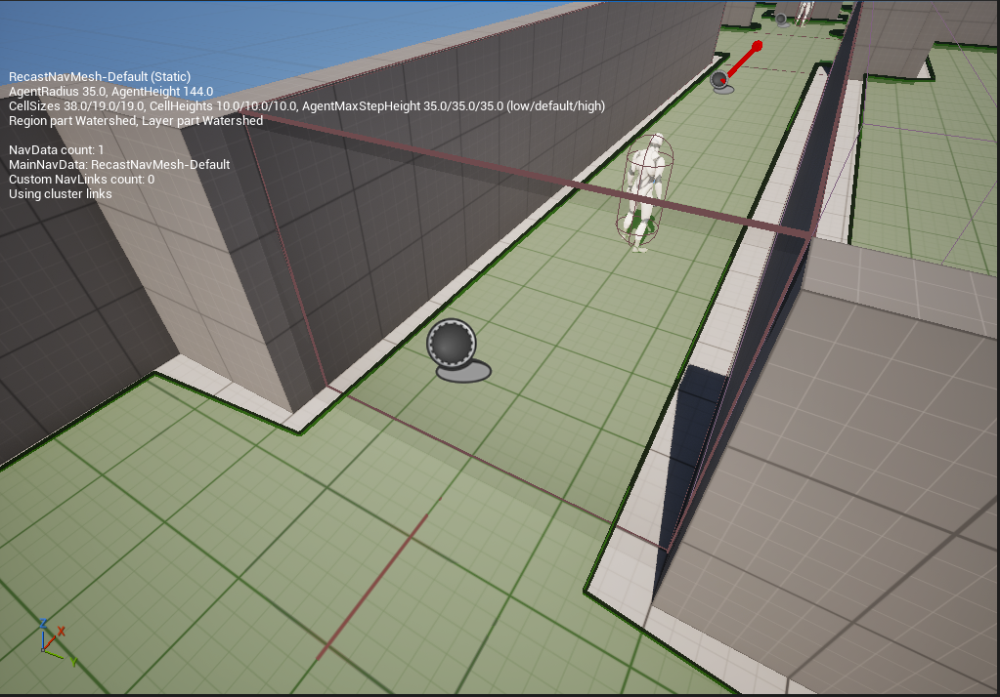

# Система смены ракурса камеры (Camera Zones)

Документация к прототипу из тестового задания SPINE. Написана для Level Designer
/ Game Designer: знание блюпринтов не требуется.

## Содержание

1. [Обзор](#1-обзор)
2. [BP_CameraZone — зона камеры](#2-bp_camerazone--зона-камеры)
3. [Режимы камеры (Data Asset)](#3-режимы-камеры-data-asset)
4. [Комбинации зон](#4-комбинации-зон)
5. [Управление в режимах](#5-управление-в-режимах)
6. [Полупрозрачная стена и каналы коллизии](#6-полупрозрачная-стена-и-каналы-коллизии)
7. [NPC-компаньон](#7-npc-компаньон)
8. [Как собрать на уровне: типовые случаи](#8-как-собрать-на-уровне-типовые-случаи)
9. [⚠️ Важное](#9-️-важное)
10. [Debug](#10-debug)
11. [Дизайнерский аспект: сценарии и новые режимы](#11-дизайнерский-аспект-сценарии-и-новые-режимы)

---

## 1. Обзор

Система состоит из трёх частей:

| Компонент                            | Что это                                                                                                                             | Кто с ним работает                      |
| ------------------------------------ | ----------------------------------------------------------------------------------------------------------------------------------- | --------------------------------------- |
| **BP_CameraZone**                    | Актор на уровне. Определяет, **где** действует режим камеры                                                                         | LD / TLD — расставляют на уровне        |
| **Режим камеры** (`DA_CameraMode_*`) | Data Asset. Определяет, **как** выглядит камера: угол, дистанция, FOV, время перехода, схема управления                             | GD / TLD — создают и настраивают режимы |
| **BPC_CameraController**             | Компонент на персонаже игрока. Плавно переводит камеру между режимами, следит, в каких зонах стоит игрок, и подстраивает управление | TLD — обычно не требует настройки       |

Связь простая: зона говорит компоненту «игрок вошёл, включи вот этот режим», а
компонент делает всё остальное.

Для проверки системы на уровне также используются **полупрозрачные стены**
(`BP_TranslucentWall`) и **NPC-компаньон** (`BP_FollowerNPC`), см. разделы 6
и 7.

---

## 2. BP_CameraZone — зона камеры

**Где лежит:** `Content/SpineTest/CameraSystem/Triggers/BP_CameraZone`

Вход игрока в объём зоны — **старт** режима, выход — **конец**. Если игрок не
находится ни в одной зоне, работает стандартная камера Third Person.

### Параметры

| Параметр                   | Что делает                                                                                     |
| -------------------------- | ---------------------------------------------------------------------------------------------- |
| **Camera Mode**            | Режим камеры внутри зоны (Data Asset из `CameraSystem/Modes`)                                  |
| **ZoneShape → Box Extent** | Размер зоны. Задаётся **половиной** размера: Extent 1000 по X = зона длиной 2000 см            |
| **Rotation актора**        | Ориентация режима. Угол камеры и направление управления отсчитываются от стрелки **Direction** |

### Как поставить зону

1. Перетащить `BP_CameraZone` на уровень.
2. В **Camera Mode** выбрать режим.
3. Растянуть зону через **ZoneShape → Box Extent** (не через Scale актора —
   тогда стрелка и линии зоны остаются нормального размера).
4. Повернуть актор так, чтобы стрелка **Direction** смотрела в нужную сторону:
   - для коридора с видом сбоку — **вдоль коридора**, камера встанет сбоку от
     стрелки;
   - для Top-Down — туда, что должно быть «верхом экрана».
5. Совместить границы зоны с местом, где должен меняться ракурс (у нас — ровно
   по полупрозрачным стенам на входе и выходе арены).

### Форма зоны

Зона может быть любой формы. В актор можно добавить несколько компонентов **Box
/ Sphere / Capsule Collision** с пресетом коллизии **PlayerTrigger**. Все фигуры
работают как одна зона: режим включается при входе в первую фигуру и выключается
при выходе из последней. Переход между фигурами внутри одной зоны ракурс не
меняет.

Пример: L-образный коридор собирается из двух Box.

### Срабатывает только от игрока

- Пресет **PlayerTrigger** реагирует только на объекты типа `Pawn`. У NPC свой
  тип коллизии `NPC`, поэтому зона его не замечает.
- Дополнительно зона проверяет, что у вошедшего есть компонент
  `BPC_CameraController` (он есть только у игрока).

---

## 3. Режимы камеры (Data Asset)

**Где лежат:** `Content/SpineTest/CameraSystem/Modes/`

Каждый режим — отдельный Data Asset на основе `PDA_CameraMode`. **Чтобы создать
новый режим, блюпринты менять не нужно:** достаточно продублировать существующий
режим (Ctrl/Cmd+D) и изменить параметры.

### Параметры режима

| Категория  | Параметр              | Что делает                                                                         |
| ---------- | --------------------- | ---------------------------------------------------------------------------------- |
| Info       | **ModeName**          | Название для отладки                                                               |
| Framing    | **ArmLength**         | Дистанция камеры от точки опоры, см                                                |
| Framing    | **CameraRotation**    | Угол камеры **относительно зоны** (Pitch — наклон, Yaw — поворот вокруг вертикали) |
| Framing    | **SocketOffset**      | Сдвиг кадра, например персонаж чуть ниже центра экрана                             |
| Framing    | **FieldOfView**       | Угол обзора                                                                        |
| Framing    | **bFixedToZone**      | ✔ — камера неподвижно висит над центром зоны; ✘ — следует за игроком               |
| Transition | **BlendTime**         | Время плавного перехода в режим и из режима, сек                                   |
| Control    | **bAllowCameraLook**  | Можно ли вращать камеру мышью                                                      |
| Control    | **bCameraCollision**  | Упирается ли камера в стены                                                        |
| Control    | **MovementInputMode** | Схема управления: `CameraRelative`, `SideScroll`, `TopDown` (см. раздел 5)         |

Угол задаётся **относительно зоны**, а не мира. Поэтому один и тот же режим
«Коридор» работает в коридоре, повёрнутом в любую сторону: достаточно повернуть
зону.

### Готовые режимы

| Режим                          | Описание                                                                                 | Основные значения                                                              |
| ------------------------------ | ---------------------------------------------------------------------------------------- | ------------------------------------------------------------------------------ |
| **DA_CameraMode_SifuCorridor** | Коридор из Sifu: вид сбоку, камера следует за игроком вдоль коридора                     | ArmLength 800,0, Yaw −90, Pitch −5, FOV 65, SideScroll, мышь ✘, коллизия ✘     |
| **DA_CameraMode_TopDownFixed** | Top-Down из Deadpool: камера строго сверху, неподвижно над комнатой, вся комната в кадре | bFixedToZone ✔, Pitch −89, FOV 70, ArmLength 1700, TopDown, мышь ✘, коллизия ✘ |

### Как подобрать параметры

Data Asset можно открыть в отдельном окне и менять во время Play. Изменения
применяются при следующем входе в зону: выйти и зайти снова.

---

## 4. Комбинации зон

Компонент помнит все зоны, в которых сейчас стоит игрок. Правила:

1. **Главная зона — последняя, в которую игрок вошёл.** Её режим и активен.
2. **Вышел из главной зоны** — включается режим предыдущей (если игрок всё ещё в
   ней).
3. **Вышел из «нижней» зоны** (не главной) — камера не меняется.
4. **Вышел из всех зон** — стандартная камера за спиной персонажа.

---

## 5. Управление в режимах

| MovementInputMode  | Как работает WASD                                           |
| ------------------ | ----------------------------------------------------------- |
| **CameraRelative** | Относительно камеры (стандартная камера)                    |
| **SideScroll**     | A / D — вдоль оси зоны (стрелки Direction), W / S отключены |
| **TopDown**        | Относительно ориентации зоны: W — «вверх по экрану»         |

Для любого режима направления берутся из угла его камеры

### Фиксация направления на границах

Когда камера меняется, клавиша, которую держит игрок, могла бы внезапно сменить
смысл (W «вперёд» → W «вверх по экрану»). Игрока разворачивало бы или
выбрасывало обратно из зоны. Поэтому:

- при смене режима **направление движения сохраняется**, пока игрок держит
  клавиши;
- управление переключается на новую камеру, **как только игрок отпустил клавиши
  или повёл мышью**.

---

## 6. Полупрозрачная стена и каналы коллизии

**Где лежит:**
`Content/SpineTest/LevelObjects/TranslucentWall/BP_TranslucentWall`

Стена **пропускает игрока и блокирует NPC**. Ограничение работает только через
коллизию: навмеш под стеной **не разрезан**. NPC «знает», что путь есть, идёт к
игроку и физически упирается в стену.

### Параметры стены

| Параметр        | Что делает                                        |
| --------------- | ------------------------------------------------- |
| **WallSize**    | Размер в см (X — толщина, Y — ширина, Z — высота) |
| **WallColor**   | Цвет                                              |
| **WallOpacity** | Прозрачность (0–1)                                |

Изменения видны в редакторе сразу.

### Каналы коллизии и пресеты

**Где:** Project Settings → Engine → Collision

| Название            | Тип                  | Настройка                                                                                            |
| ------------------- | -------------------- | ---------------------------------------------------------------------------------------------------- |
| **NPC**             | Object Channel       | Default Response = Block: весь мир блокирует NPC как обычного персонажа                              |
| **NPCPawn**         | Preset (капсула NPC) | Object Type = NPC, ответы как у Pawn                                                                 |
| **TranslucentWall** | Preset (стена)       | Query Only, всё Ignore, кроме **NPC = Block**. Camera = Ignore — камера игрока не «въезжает» в стену |
| **PlayerTrigger**   | Preset (зоны камеры) | Query Only, всё Ignore, кроме **Pawn = Overlap**                                                     |

У стены выключено **Can Ever Affect Navigation**: именно поэтому навмеш под ней
цельный.

---

## 7. NPC-компаньон

**Где лежит:** `Content/SpineTest/NPC/BP_FollowerNPC`

NPC стоит на месте, пока игрок не подойдёт, потом следует за ним и держит
дистанцию. Ограничен только полупрозрачными стенами.

| Параметр (категория Follower) | По умолчанию | Что делает                                                                      |
| ----------------------------- | ------------ | ------------------------------------------------------------------------------- |
| **ActivationRadius**          | 600          | С какого расстояния NPC «замечает» игрока                                       |
| **FollowDistance**            | 250          | На какой дистанции от игрока останавливается                                    |
| **UpdateInterval**            | 0.25         | Как часто перепроверяет дистанцию, сек                                          |
| **DistanceTolerance**         | 50           | [уточнить: если вынесено в параметр] Зазор против дёрганья на границе дистанции |

Требования к уровню: **Nav Mesh Bounds Volume** должен покрывать всю зону, где
ходит NPC.

---

## 8. Как собрать на уровне: типовые случаи

Пошаговые инструкции для трёх типовых случаев. Все три собраны на тестовом
уровне — их можно открыть и посмотреть.

### 8.1. Отрезок уровня с видом сбоку

**Задача:** игрок проходит коридор в профиль и двигается только вдоль него. **На
уровне:** зона 1, `CameraZone_Sifu`.

1. Поставить `BP_CameraZone`, в **Camera Mode** выбрать
   `DA_CameraMode_SifuCorridor`.
2. Повернуть актор так, чтобы стрелка **Direction** смотрела вдоль коридора.
   Коридор может идти под любым углом — камера и управление повернутся вместе с
   зоной.
3. В **ZoneShape → Box Extent** задать половину длины и ширины коридора. Границы
   зоны совместить с входом и выходом.
4. Стену со стороны камеры (камера встаёт справа по ходу стрелки) заменить на
   пару:
   - **Plane** лицом внутрь коридора — изнутри уровня выглядит как стена, для
     камеры прозрачна;
   - **Blocking Volume** с `Camera = Ignore` — держит игрока и NPC, но не мешает
     камере. **Результат:** при входе камера уходит в профиль, A/D ведут вдоль
     коридора, W/S отключены. При выходе — возврат за спину.

### 8.2. Комнаты с видом сверху, камера переезжает из комнаты в комнату

**Задача:** несколько комнат, над каждой неподвижная камера; при переходе камера
плавно переезжает к следующей комнате. **На уровне:** зона 2,
`CameraZone_TopDown_A` и `CameraZone_TopDown_B`.

1. На каждую комнату поставить свою `BP_CameraZone` с режимом
   `DA_CameraMode_TopDownFixed`.
2. Актор зоны — **в центр комнаты** (камера висит над позицией актора).
3. Зоны поставить вплотную, граница — по проёму между комнатами.
4. Стрелку **Direction** направить туда, что должно быть «верхом экрана».
   **Результат:** камера переезжает из комнаты в комнату без возврата к
   стандартной камере. Отдельной настройки для этого не нужно — так работают
   правила комбинаций зон (раздел 4).

**Совет:** комнату лучше делать вытянутой по ширине, близко к 16:9 (на уровне —
1000 × 2000 см). Так она заполняет кадр, а персонаж крупнее.

### 8.3. Сменить ракурс на время внутри другой зоны

**Задача:** внутри участка с одним ракурсом нужен короткий фрагмент с другим,
например боковая комната с видом сверху посреди коридора.

1. Поставить маленькую `BP_CameraZone` с нужным режимом **внутри** большой.
2. Больше ничего настраивать не нужно. **Результат:** вошёл в маленькую зону —
   её ракурс; вышел — снова ракурс большой зоны.

---

## 9.Важное

- **Pitch −89, а не −90.** При взгляде строго вниз поворот камеры вырождается, и
  направление управления становится непредсказуемым. На глаз разница в 1°
  незаметна.
- **Размер зоны — через Box Extent**, не через Scale.
- **Invisible / Blocking Volume рядом с камерой** — всегда `Camera = Ignore`,
  иначе spring arm укорачивается о них.
- **Коллизия камеры во время перехода отключена** и включается после окончания
  бленда, иначе длинный spring arm цепляет стены, и кадр «прыгает».

---

## 10. Debug

| Что                       | Как                                                                                      |
| ------------------------- | ---------------------------------------------------------------------------------------- |
| Переключить режим вручную | Клавиши **1** (Sifu), **2** (Top-Down), **0** (стандартная) — только в редакторе         |
| Ошибки компонента         | Если на персонаже нет Spring Arm / Camera, компонент пишет ошибку на экран и отключается |

---

## 11. Дизайнерский аспект: сценарии и новые режимы

### 11.1. Альтернативные сценарии с текущими режимами

#### «Этаж сквозь потолок» (режим Top-Down, комнаты)

Референс: сцена с патронами Dragon's Breath в «Джоне Уике 4» (2023) — длинный
кадр сверху, камера проходит над стенами из комнаты в комнату.

Цепочка небольших комнат (офис, склад, коридор), над каждой — фиксированная
камера. При переходе в следующую комнату камера переезжает над перегородкой —
как в референсе, без склейки. Каждая смена комнаты синхронизирована с
музыкальным акцентом, а в «чистой» комнате музыка стихает. Игрок читает
раскладку комнаты целиком до боя и планирует маршрут, как тактическую задачу.

#### «Переход над каньоном» (режим Sifu, вид сбоку)

Игрок идёт по узкой балке, верёвочному мосту или карнизу над пропастью. Камера
уходит в профиль и отъезжает, чтобы в кадре были высота и пустота под ногами.
Управление только вперёд и назад.

Референсы:

- **Uncharted 2: Among Thieves** — уровень с поездом, классика «экшен-сета» в
  движении. В
  [разборе 80.lv](https://80.lv/articles/the-secrets-of-the-train-level-in-uncharted-2)
  описано, как устроен трек и как кат-сцены прячут переходы между участками.
- **Tomb Raider** — в серии есть отдельная механика балансирования на узких
  балках и брёвнах
  ([Tomb Raider Wiki: Balance](https://www.tombraiderwiki.org/index.php/Balance)).
  Проход над пропастью — постоянный приём серии.
- **Кино:** верёвочный мост в «Индиане Джонсе и Храме судьбы» (1984)
  ([видео](https://www.youtube.com/watch?v=ww8xT6OANU4)).

#### «Подъём по стене» (смена ракурса как в Indiana Jones)

На стене включается режим Sifu (камера сбоку и чуть дальше), чтобы игрок видел
маршрут зацепов и высоту. Наверху возвращается стандартная камера.

Референс: **Indiana Jones and the Great Circle** (2024). Игра почти вся от
первого лица, но на время лазания, качания на кнуте и спуска по тросу камера
переключается в третье лицо, а потом возвращается обратно
([GamePressure](https://www.gamepressure.com/newsroom/indiana-jones-great-circle-can-you-play-in-third-person/z176bb)).
По сути это наша механика: зона действия, внутри которой меняется ракурс, а на
выходе он возвращается.

### 11.2. Новые режимы камеры

#### Режим «Длинный план на рельсе» (Rail Long Take)

Референc: драка на лестнице в «Взрывной блондинке» (2017).

Камера не привязана к игроку, а едет по заранее проложенному сплайну, всегда
чуть впереди или сбоку, выдерживая «операторскую» дистанцию. Точка на сплайне
выбирается ближайшей к игроку, поэтому камера проходит маршрут вместе с ним: из
коридора на лестницу, через дверной проём в соседнее помещение.

#### Режим «Камера наблюдения» (Static Security Cam)

Референс: «Скрытое» (Михаэль Ханеке, 2005),

Неподвижная камера в верхнем углу помещения, широкий FOV, лёгкое «рыбий
глаз»-искажение и шум в постобработке. Игрок проходит помещение, видя себя как
будто со стороны охраны. Подходит для стелс-эпизодов или моментов перед засадой.
